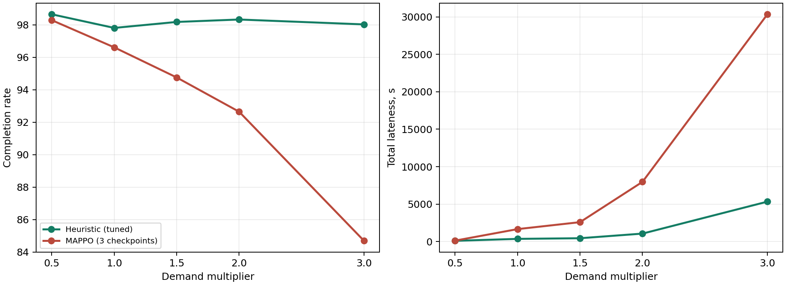

# Heuristic so với MAPPO: so sánh ghép cặp, tune S4 và quét tải

## Theo kịch bản

Trong bảng, H là heuristic và M là MAPPO. **Hoàn thành** là tỷ lệ đơn xử lý xong (càng cao càng tốt). **Trễ** là tổng thời gian các đơn bị quá hạn (càng thấp càng tốt). Đơn chưa xong được tính trễ đến cuối lượt chạy.

Cột **chênh lệch (Δ)** lấy kết quả MAPPO trừ heuristic. Vì vậy, Δ hoàn thành dương nghĩa là MAPPO hoàn thành nhiều hơn; Δ trễ âm nghĩa là MAPPO ít trễ hơn.

Khoảng số trong ngoặc vuông là **CI 95%**: khoảng ước tính cho chênh lệch khi lấy mẫu lại 5 bộ đơn hàng và 3 mô hình MAPPO, tổng cộng 20.000 lần. Nếu khoảng này chứa số 0, kết quả chưa cho thấy bên nào hơn rõ ràng ở chỉ số đó.

| Nhóm | Kịch bản | Nguồn | Hoàn thành H / M (%) | Δ hoàn thành (điểm %, CI 95%) | Trễ H / M (giây) | Δ trễ (giây, CI 95%) |
|---|---|---|---:|---:|---:|---:|
| tải đều | S1 | lượt 360 | 99.1 / 97.8 | -1.4 [-2.8, -0.3] | 42 / 254 | +213 [+31, +544] |
| tải đều | S2 | lượt 360 | 99.0 / 98.8 | -0.2 [-0.6, +0.0] | 48 / 209 | +161 [+107, +250] |
| tải đều | S3 | lượt 360 | 97.9 / 97.7 | -0.2 [-0.9, +0.6] | 41 / 181 | +141 [+84, +195] |
| tải đều | OOD_A | Study14 gốc | 98.1 / 97.8 | -0.3 [-0.9, +0.1] | 54 / 145 | +91 [+20, +161] |
| tải căng | S4 | lượt 360 | 99.2 / 96.5 | -2.7 [-6.6, -0.1] | 896 / 3341 | +2445 [-37, +7050] |
| tải căng | S9 | lượt 360 | 98.1 / 97.9 | -0.1 [-0.5, +0.1] | 293 / 203 | -90 [-566, +182] |
| khác | S5 | lượt 360 | 97.5 / 96.5 | -1.0 [-1.9, -0.5] | 267 / 267 | -1 [-454, +258] |
| khác | S6 | lượt 360 | 98.5 / 98.6 | +0.1 [-0.5, +0.7] | 221 / 188 | -33 [-293, +111] |
| khác | S7 | lượt 360 | 97.6 / 96.5 | -1.1 [-2.4, -0.1] | 30 / 207 | +177 [+135, +217] |
| khác | S8 | lượt 360 | 98.8 / 98.8 | +0.0 [+0.0, +0.0] | 152 / 253 | +102 [+11, +252] |

Nguồn S1–S9: `runs/study14_current_source_testonly/episodes.csv` (360 episode, seed 3005–3009). OOD_A vắng mặt ở lượt 360; dòng OOD_A dùng `runs/study14/episodes.csv` gốc (seed 2000–2004), do đó không gộp với lượt 360. Checkpoint MAPPO đã train trên source cũ; lượt 360 là phép thử chuyển source và seed đã được quan sát trước đó. Heuristic gốc dùng ngưỡng sạc 20% theo `selected_baselines.json`.

Source hash lượt 360: `8bb96d90d4c7ac92595fdb4805c33ce5ffb958736237611a42f5b59948319c95`; source hash thí nghiệm mới: `0dfa553da4ee08622977f67fb60b54ece07588056f98dcfbb1fcaca4882a187f`.

## Tune ngưỡng sạc heuristic trên S4

- S4 tune ngưỡng 20%: 5 episode, hoàn thành 97.96%, trễ 154.1 giây.
- S4 tune ngưỡng 30%: 5 episode, hoàn thành 98.12%, trễ 79.9 giây.
- S4 tune ngưỡng 40%: 5 episode, hoàn thành 97.96%, trễ 2823.6 giây.
- MAPPO: 15 episode (3 checkpoint × 5 tape), hoàn thành 97.47%, trễ 349.2 giây.

Ngưỡng chọn theo quy tắc định trước (hoàn thành cao nhất, rồi trễ thấp nhất): **30%**. MAPPO có 3 checkpoint × 5 tape = 15 episode trên cùng seed tune; heuristic có 3 ngưỡng × 5 tape = 15 episode. Đây là ngân sách đánh giá bằng nhau theo số episode/tape, không phải thời gian CPU hoặc ngân sách train bằng nhau. Kết quả tune không được dùng để tuyên bố thắng trên S4; xem tập test bên dưới.

## Quét tải S4 trên seed test tách biệt

Giữ cấu hình S4 và burst multiplier=2; nhân `demand_per_hour` 90 đơn/giờ với 0,5×, 1×, 1,5×, 2×, 3×. Mỗi mức dùng 5 tape seed 4100–4104, heuristic đã chọn ngưỡng và 3 checkpoint MAPPO trên cùng tape. 8 đơn ban đầu giữ nguyên; do đó số đơn thực tế không nhân đúng tỷ lệ tuyệt đối.

| Tải | Đơn đến TB | Hoàn thành H / M (%) | Δ hoàn thành (điểm %, CI 95%) | Trễ H / M (giây) | Δ trễ (giây, CI 95%) |
|---:|---:|---:|---:|---:|---:|
| 0.5× | 58.0 | 98.7 / 98.3 | -0.4 [-1.1, +0.3] | 91 / 117 | +26 [-81, +90] |
| 1× | 104.8 | 97.8 / 96.6 | -1.2 [-2.7, +0.0] | 352 / 1656 | +1304 [-148, +3888] |
| 1.5× | 153.6 | 98.2 / 94.8 | -3.4 [-5.7, -1.1] | 438 / 2585 | +2147 [+461, +3992] |
| 2× | 193.6 | 98.3 / 92.6 | -5.7 [-9.3, -2.2] | 1056 / 7969 | +6913 [+1433, +13003] |
| 3× | 286.0 | 98.0 / 84.7 | -13.3 [-20.8, -6.5] | 5325 / 30354 | +25029 [+10362, +41068] |



Trên 100 episode quét tải: 0 sự cố an toàn và 0 tác vụ thất lạc.

Ở mức 1× trên seed test tách biệt, chưa có bằng chứng MAPPO hơn heuristic đã tune đồng thời ở cả hoàn thành và trễ theo CI ghép cặp. Không thể đưa ra kết luận MAPPO thắng S4 sau tune.

Không quan sát thấy đường trung bình hoàn thành cắt nhau trong lưới tải đã đo.
Không quan sát thấy đường trung bình trễ cắt nhau trong lưới tải đã đo.
Giả thuyết có điểm giao trong khoảng 0,5×–3× chưa được xác nhận bởi thí nghiệm này.

## OOD_A trên source hiện tại

Với 5 seed test 4100–4104, hoàn thành heuristic/MAPPO: 98.1% / 97.6%; Δ=-0.5 [-1.3, +0.2] điểm %. Trễ: 278 / 208 giây; Δ=-70 [-542, +199] giây. Kết quả này thuộc thí nghiệm mới, không phải lượt 360.

## Giới hạn

- Mỗi mức chỉ có 5 tape và 3 checkpoint; CI bootstrap nhạy với mẫu ít. Không coi nhiều checkpoint trên cùng tape là 15 tape độc lập.
- `total_lateness_s` gồm cả tác vụ còn chờ tại cuối 3600 giây; vì vậy nó phản ánh cả backlog bị kiểm duyệt ở chân trời mô phỏng.
- MAPPO checkpoint train trên source cũ, nên phép đo này kiểm tra khả năng chuyển source của checkpoint; không chứng minh giới hạn tối đa của MAPPO.
- Quét tải chỉ thay đổi cường độ đơn trên S4; không tự động suy rộng sang S9 hoặc các dạng OOD khác.

## Tái lập

Chạy từ gốc repository bằng môi trường Python đã cài FleetRL. Runner kiểm tra source hash và SHA-256 của ba checkpoint trước khi chạy; episode hoàn tất được lưu dưới `runs/heuristic_mappo_load_20261015/` và có thể tiếp tục bằng cùng lệnh. Bản CSV gọn của toàn bộ 150 episode mới là `reports/heuristic_mappo_new_episodes_20261015.csv`.

```powershell
python scripts/run_heuristic_mappo_load.py tune
python scripts/run_heuristic_mappo_load.py sweep
python scripts/run_heuristic_mappo_load.py ood
python scripts/analyze_heuristic_mappo_load.py
```
